# Northstar Data Model

Oct 22, 2026 · @Abhishek

## 1. Conventions

The schema runs on Supabase Postgres (Mumbai), managed by Flyway migrations in `db/migrations/`; every rule below applies to every table unless the table says otherwise.

| Topic | Rule |
| --- | --- |
| Primary keys | `id uuid primary key default gen_random_uuid()` |
| Tenant scope | Every business-owned table has `tenant_id uuid not null references tenants(id)`, including join and history tables |
| Timestamps | `created_at timestamptz not null default now()`, `updated_at timestamptz` (trigger-maintained); stored in UTC, shown in the tenant timezone |
| Money | `bigint` in paise (₹1 = 100) with `currency char(3) default 'INR'`; never floats |
| Tax rates | `numeric(5,2)` percent (e.g. 18.00) |
| Phones | E.164 text (`+919876543210`) in `normalized_phone` |
| Enumerations | `text` + `check` constraint listing allowed values (easier to migrate than Postgres enum types) |
| Flexible fields | `jsonb` only for business-specific extras (`requirements`, `config`); anything queried or joined is a typed column |
| Soft delete | `deleted_at timestamptz` on contacts, leads, catalogue items, users; financial records are never deleted |
| Optimistic locking | `version int not null default 1` on leads, quotes, appointments; updates check and increment it |
| Append-only | `timeline_events`, `audit_log`, `webhook_events`, `lead_score_history`, `payments` status history: insert only |
| Secrets | Never in tables readable by tenants; credentials stored encrypted, referenced by id |
| Naming | snake\_case, plural table names, `<table>_id` foreign keys |

## 2. At a glance

About 60 tables in nine groups; the lead sits at the centre and every group links to it.

&#91;embedded content: table groups · 9 groups around the lead\]

Tenancy links to everything through tenant\_id; webhook\_events is the one table whose tenant is resolved after arrival.

### Full entity-relationship diagram

All 59 tables and their foreign keys. Every table also carries `tenant_id`; tenant links are drawn only for tables with no other parent, to keep the diagram readable.

```mermaid
erDiagram
  %% Tenancy and platform billing
  tenants ||--o{ memberships : has
  user_profiles ||--o{ memberships : "belongs via"
  tenants ||--o{ invites : sends
  memberships ||--o{ staff_skills : has
  memberships ||--o{ staff_leave : takes
  plans ||--o{ subscriptions : "priced by"
  tenants ||--o{ subscriptions : has
  subscriptions ||--o{ subscription_invoices : bills
  tenants ||--o{ usage_alerts : receives

  %% Contacts and messages
  tenants ||--o{ contacts : owns
  contacts ||--o{ contact_sources : "arrived from"
  contacts ||--o{ conversations : has
  conversations ||--o{ messages : contains
  tenants ||--o{ message_templates : owns
  message_templates ||--o{ messages : "used by"
  tenants ||--o{ faq_entries : owns

  %% Attribution
  tenants ||--o{ chat_links : creates
  chat_links ||--o{ link_clicks : logs
  contacts ||--o{ ad_referrals : "came via"
  tenants ||--o{ ad_spend_daily : tracks
  chat_links ||--o{ contact_sources : tags
  ad_referrals ||--o{ contact_sources : tags

  %% Workflow and leads
  tenants ||--o{ workflows : configures
  workflows ||--o{ workflow_versions : publishes
  contacts ||--o{ leads : "has"
  conversations ||--o{ leads : "talks in"
  workflow_versions ||--o{ leads : runs
  ad_referrals |o--o{ leads : sources
  chat_links |o--o{ leads : sources
  link_clicks }o--o| leads : "matched to"
  memberships |o--o{ leads : "assigned to"
  leads ||--o{ lead_fields : stores
  messages |o--o{ lead_fields : "extracted from"
  leads ||--o{ lead_score_history : scores
  leads ||--o{ events : receives
  leads ||--o{ actions : runs
  leads ||--o{ timers : schedules

  %% Commercial
  tenants ||--o{ catalogue_items : sells
  leads ||--o{ quotes : gets
  quotes ||--o{ quote_versions : versions
  quote_versions ||--o{ quote_lines : lists
  catalogue_items |o--o{ quote_lines : "copied into"
  leads ||--o{ payments : pays
  quote_versions ||--o{ payments : "accepted as"
  payments ||--o{ invoices : "invoiced by"
  tenants ||--o{ invoice_sequences : numbers
  tenants ||--o{ invoice_templates : designs
  invoice_templates |o--o{ invoices : formats
  invoices ||--o{ invoice_lines : lists
  invoices ||--o{ credit_notes : "cancelled by"
  payments ||--o{ refunds : refunds
  credit_notes |o--o| refunds : documents
  tenants ||--o{ cancellation_policies : sets

  %% Scheduling
  memberships ||--o{ calendar_connections : connects
  memberships ||--o{ busy_blocks : "is busy"
  leads ||--o{ slot_holds : holds
  memberships ||--o{ slot_holds : "held for"
  payments |o--o| slot_holds : secures
  leads ||--o{ appointments : books
  memberships ||--o{ appointments : "works"
  appointments ||--o{ appointment_assignments : "reassigned via"
  leads ||--o{ tasks : has
  appointments |o--o{ tasks : includes
  memberships ||--o{ tasks : owns

  %% Integrations
  tenants ||--o{ integrations : connects
  integration_credentials ||--o{ integrations : authorises
  integration_credentials ||--o{ calendar_connections : authorises
  tenants ||--o{ whatsapp_accounts : owns
  tenants ||--o{ sheet_mappings : maps
  tenants ||--o{ sync_outbox : queues
  tenants ||--o{ sheet_conflicts : reviews
  leads ||--o{ meta_events : reports
  tenants |o--o{ webhook_events : "resolved to"

  %% Timeline and audit
  leads ||--o{ timeline_events : records
  leads ||--o{ notes : has
  leads ||--o{ attachments : stores
  tenants ||--o{ audit_log : audits
  tenants ||--o{ usage_daily : meters
```



Notation: `||--o{` one to many, `|o--o{` optional one to many, `|o--o|` optional one to one, `}o--o|` many to optional one.

## 3. Tenancy and access

A tenant is one client business; users come from Supabase Auth and get access to a tenant only through a membership row.

| Table | Columns (type) | Constraints / notes |
| --- | --- | --- |
| `tenants` | id, name, slug (text), industry (text), timezone (text, default 'Asia/Kolkata'), locale (text), brand\_tone (text), legal\_name (text), gstin (text), state\_code (char(2)), billing\_address (jsonb), approval\_mode (bool, default true), quiet\_hours (jsonb), status (text), plan\_id (uuid), activated\_at, created\_at, updated\_at | slug unique; status in ('onboarding','active','paused','suspended','closed'); not active until paid or trial override |
| `user_profiles` | id (= auth.users.id), full\_name, phone, avatar\_path, is\_platform\_admin (bool), created\_at, deleted\_at | One row per Supabase Auth user; is\_platform\_admin only settable by Northstar |
| `memberships` | id, tenant\_id, user\_id, role (text), status (text), whatsapp\_phone (text), created\_at, updated\_at | unique (tenant\_id, user\_id); role in ('admin','staff'); status in ('invited','active','deactivated') |
| `invites` | id, tenant\_id, email (citext), role, token\_hash (text), invited\_by, expires\_at, accepted\_at, revoked\_at | Token stored hashed; expires 7 days after creation |
| `staff_skills` | id, tenant\_id, membership\_id, skill (text) | unique (membership\_id, skill); used by assignment rules |
| `staff_leave` | id, tenant\_id, membership\_id, starts\_on (date), ends\_on (date), reason (text), created\_by | ends\_on ≥ starts\_on; overlapping appointments flagged on insert |

## 4. Contacts, conversations and messages

A contact is one phone number per tenant; it can have many leads over time but one ongoing WhatsApp conversation.

| Table | Columns (type) | Constraints / notes |
| --- | --- | --- |
| `contacts` | id, tenant\_id, normalized\_phone, name, email, is\_repeat\_customer (bool), consent\_state (text), opted\_in\_at, opt\_out\_at, attributes (jsonb), created\_at, updated\_at, deleted\_at | unique (tenant\_id, normalized\_phone); consent\_state in ('unknown','opted\_in','opted\_out') |
| `contact_sources` | id, tenant\_id, contact\_id, source (text), chat\_link\_id, ad\_referral\_id, first\_seen\_at | One row per distinct source a contact arrived from |
| `conversations` | id, tenant\_id, contact\_id, channel (text), whatsapp\_phone\_number\_id (text), status (text), ai\_paused (bool), assigned\_membership\_id, last\_inbound\_at, window\_expires\_at, needs\_human (bool), created\_at, updated\_at | unique (tenant\_id, contact\_id, channel); window\_expires\_at = last\_inbound\_at + 24 h |
| `messages` | id, tenant\_id, conversation\_id, direction (text), sender\_type (text), sender\_membership\_id, provider\_message\_id (text), type (text), body (text), media\_path, template\_id, status (text), error\_code, sent\_at, delivered\_at, read\_at, created\_at | unique (tenant\_id, provider\_message\_id); direction in ('in','out'); sender\_type in ('contact','ai','staff','system'); status in ('queued','sent','delivered','read','failed') |
| `message_templates` | id, tenant\_id, name, language, category (text), body, variables (jsonb), provider\_template\_id, status (text), approved\_at | unique (tenant\_id, name, language); status in ('draft','submitted','approved','rejected','paused'); category as returned by Meta |
| `faq_entries` | id, tenant\_id, question, answer, is\_active, updated\_by, updated\_at | Only source the AI may answer from |

## 5. Attribution

Every lead points to exactly one origin: a Meta ad referral, a chat-link click, or direct.

| Table | Columns (type) | Constraints / notes |
| --- | --- | --- |
| `chat_links` | id, tenant\_id, code (text), name, source (text), utm (jsonb), prefill\_text, qr\_path, is\_active, created\_by, created\_at | code unique platform-wide (used in `northstar.com/c/<code>`); source in ('website','email','instagram','facebook','other') |
| `link_clicks` | id, tenant\_id, chat\_link\_id, ref\_code (text), clicked\_at, page\_url, utm (jsonb), user\_agent\_hash, matched\_lead\_id | ref\_code unique; matched when the pre-filled message arrives; raw IP not stored |
| `ad_referrals` | id, tenant\_id, contact\_id, ctwa\_click\_id (text), source\_id (ad id), source\_type, source\_url, headline, campaign\_id, campaign\_name, adset\_id, ad\_name, received\_at | Filled from the WhatsApp referral payload; campaign names enriched from Marketing API |
| `ad_spend_daily` | id, tenant\_id, date, campaign\_id, adset\_id, ad\_id, spend\_paise, impressions, clicks, pulled\_at | unique (tenant\_id, date, ad\_id); for cost-per-qualified-lead reports |

## 6. Workflow and leads

The lead is the central record: it belongs to a contact, runs on one workflow version, and every other business table hangs off it.

| Table | Columns (type) | Constraints / notes |
| --- | --- | --- |
| `workflows` | id, tenant\_id, name, template (text), current\_version\_id, draft\_config (jsonb), created\_at, updated\_at | One active workflow per tenant in MVP |
| `workflow_versions` | id, tenant\_id, workflow\_id, version (int), config (jsonb), published\_by, published\_at | unique (workflow\_id, version); immutable after insert (no update grant) |
| `leads` | id, tenant\_id, contact\_id, conversation\_id, workflow\_version\_id, stage (text), previous\_stage (text), stage\_entered\_at, origin (text), ad\_referral\_id, chat\_link\_id, service (text), event\_date (date), event\_time (time), location (text), location\_geo (point), budget\_paise (bigint), requirements (jsonb), score (smallint), band (text), score\_reasons (jsonb), junk\_rule\_id (text), lost\_reason (text), assigned\_membership\_id, amount\_due\_paise (bigint), version (int), created\_at, updated\_at, closed\_at, deleted\_at | stage must exist in the version config; band in ('hot','warm','cold','junk'); origin in ('meta\_ad','chat\_link','direct','manual'); score 0–100 |
| `lead_fields` | id, tenant\_id, lead\_id, field (text), value (jsonb), confidence (numeric(3,2)), source\_message\_id, set\_by (text), created\_at | Every extracted/edited field value with provenance; latest per field = current |
| `lead_score_history` | id, tenant\_id, lead\_id, score, band, reasons (jsonb), model, prompt\_version, created\_at | Append-only |
| `events` | id, tenant\_id, lead\_id, type (text), dedupe\_key (text), payload (jsonb), received\_at, processed\_at | unique (tenant\_id, dedupe\_key); engine input log |
| `actions` | id, tenant\_id, lead\_id, type (text), status (text), idempotency\_key (text), mode (text), payload (jsonb), result (jsonb), attempts (int), next\_attempt\_at, last\_error, approver\_membership\_id, approved\_at, stage\_entry\_id, created\_at, updated\_at | unique (tenant\_id, idempotency\_key); status in ('pending','processing','succeeded','failed','needs\_review','skipped','cancelled'); mode in ('approval','automatic') |
| `timers` | id, tenant\_id, lead\_id, type (text), fire\_at, job\_id (text), status (text), created\_at | Mirror of scheduled JobRunr jobs so the engine can cancel them; status in ('scheduled','fired','cancelled') |

JobRunr creates its own `jobrunr_*` tables in a separate schema; they hold no tenant data beyond IDs in job arguments.

## 7. Commercial

Quotes are versioned, payments form a ledger keyed by Razorpay IDs, and invoices are numbered per financial year and never deleted.

| Table | Columns (type) | Constraints / notes |
| --- | --- | --- |
| `catalogue_items` | id, tenant\_id, name, description, unit\_price\_paise, hsn\_sac (text), tax\_rate (numeric(5,2)), is\_active, created\_at, updated\_at, deleted\_at | Changing a price never changes sent quotes |
| `quotes` | id, tenant\_id, lead\_id, current\_version\_id, status (text), created\_at | status in ('open','accepted','closed') |
| `quote_versions` | id, tenant\_id, quote\_id, version (int), subtotal\_paise, discount\_paise, tax\_paise, total\_paise, valid\_until (date), status (text), discount\_approved\_by, pdf\_path, sent\_at, accepted\_at, created\_by, created\_at | unique (quote\_id, version); status in ('draft','needs\_review','sent','accepted','changes\_requested','superseded','expired'); only latest sent version acceptable |
| `quote_lines` | id, tenant\_id, quote\_version\_id, catalogue\_item\_id, description, qty (numeric), unit\_price\_paise, hsn\_sac, tax\_rate, line\_total\_paise | Copied values, not references, so history stays exact |
| `payments` | id, tenant\_id, lead\_id, quote\_version\_id, kind (text), amount\_paise, status (text), razorpay\_link\_id, razorpay\_link\_url, razorpay\_payment\_id, link\_expires\_at, paid\_at, failure\_reason, created\_at, updated\_at | unique (tenant\_id, razorpay\_payment\_id) where not null; kind in ('full','advance','partial','balance','fee'); status in ('pending','paid','failed','expired','refunded','partially\_refunded','refund\_due') |
| `invoice_sequences` | id, tenant\_id, financial\_year (text, e.g. '2026-27'), prefix, next\_number (int) | unique (tenant\_id, financial\_year); incremented in the same transaction as invoice insert, so no gaps |
| `invoices` | id, tenant\_id, lead\_id, payment\_id, number (text), financial\_year, issue\_date, place\_of\_supply (char(2)), supplier\_state (char(2)), subtotal\_paise, cgst\_paise, sgst\_paise, igst\_paise, total\_paise, status (text), template\_id, pdf\_path, sent\_at, cancelled\_at, created\_at | unique (tenant\_id, number); status in ('draft','issued','partially\_paid','paid','overdue','cancelled'); no delete grant |
| `invoice_lines` | id, tenant\_id, invoice\_id, description, hsn\_sac, qty, unit\_price\_paise, tax\_rate, taxable\_paise, tax\_paise | Copied values |
| `credit_notes` | id, tenant\_id, invoice\_id, number, reason, amount\_paise, tax\_paise, issue\_date, pdf\_path, created\_by | unique (tenant\_id, number) |
| `refunds` | id, tenant\_id, payment\_id, amount\_paise, policy\_snapshot (jsonb), status (text), requested\_by, approved\_by, approved\_at, razorpay\_refund\_id, processed\_at, credit\_note\_id | status in ('requested','approved','rejected','processing','processed','failed') |
| `invoice_templates` | id, tenant\_id, name, docx\_path, field\_mapping (jsonb), is\_default, created\_by, created\_at | One default per tenant (partial unique index) |
| `cancellation_policies` | id, tenant\_id, rules (jsonb), is\_active, updated\_at | e.g. hours-before thresholds → refund % |

## 8. Scheduling

The platform's appointments table is the master schedule; Google Calendar event IDs are stored alongside so every change can be mirrored.

| Table | Columns (type) | Constraints / notes |
| --- | --- | --- |
| `calendar_connections` | id, tenant\_id, membership\_id (null = business calendar), google\_calendar\_id, credential\_id, status (text), last\_synced\_at | status in ('connected','error','disconnected') |
| `busy_blocks` | id, tenant\_id, membership\_id, starts\_at, ends\_at, source (text), google\_event\_id, is\_private (bool), synced\_at | Free/busy cache from Google; private events stored as busy only, no title |
| `slot_holds` | id, tenant\_id, lead\_id, membership\_id, starts\_at, ends\_at, payment\_id, expires\_at, status (text) | status in ('held','converted','released'); exclusion constraint prevents overlapping active holds per staff |
| `appointments` | id, tenant\_id, lead\_id, kind (text), starts\_at, ends\_at, location, assigned\_membership\_id, status (text), google\_event\_ids (jsonb), version (int), created\_at, updated\_at, cancelled\_at | kind in ('call','site\_visit','job','meeting'); status in ('scheduled','in\_progress','done','cancelled','rescheduled'); exclusion constraint on (assigned\_membership\_id, tstzrange) for active rows |
| `appointment_assignments` | id, tenant\_id, appointment\_id, from\_membership\_id, to\_membership\_id, reason (text), changed\_by, changed\_at | Append-only reassignment history |
| `tasks` | id, tenant\_id, lead\_id, appointment\_id, title, owner\_membership\_id, due\_at, status (text), completed\_at, created\_by, created\_at | status in ('open','done','overdue','cancelled') |

Staff leave lives in `staff_leave` (section 3).

## 9. Integrations, sync and webhooks

Credentials sit in a server-only table that tenants can never read; everything leaving the platform for Sheets or Meta goes through an outbox.

| Table | Columns (type) | Constraints / notes |
| --- | --- | --- |
| `integrations` | id, tenant\_id, provider (text), status (text), account\_label, scopes (text\[\]), credential\_id, last\_success\_at, last\_error, last\_error\_at, created\_at, updated\_at | unique (tenant\_id, provider) except calendars; provider in ('whatsapp','razorpay','google','meta\_ads','meta\_capi') |
| `integration_credentials` | id, tenant\_id, provider, encrypted\_secret (bytea), key\_id (text), expires\_at, rotated\_at | **Private schema**, no RLS access for app users; read only by the backend service role; encrypted with a managed key |
| `whatsapp_accounts` | id, tenant\_id, waba\_id, phone\_number\_id, display\_phone, display\_name, quality\_rating, messaging\_limit, verified\_at | unique (phone\_number\_id) platform-wide; routes inbound webhooks to the tenant |
| `sheet_mappings` | id, tenant\_id, spreadsheet\_id, tab (text), entity (text), field\_map (jsonb), inbound\_fields (text\[\]), last\_synced\_at, status | entity in ('leads','payments') |
| `sync_outbox` | id, tenant\_id, target (text), entity, entity\_id, operation (text), payload (jsonb), status (text), attempts, next\_attempt\_at, last\_error, created\_at | target in ('sheets','meta\_capi'); processed in batches by the worker |
| `sheet_conflicts` | id, tenant\_id, entity\_id, field, sheet\_value, platform\_value, detected\_at, resolved\_by, resolved\_at | Review list for protected-field edits |
| `meta_events` | id, tenant\_id, lead\_id, event\_name (text), event\_id (text), value\_paise, ctwa\_click\_id, sent\_at, response (jsonb), status | unique (tenant\_id, lead\_id, event\_name); Meta does not deduplicate business-messaging events, so Northstar sends each once |
| `webhook_events` | id, provider, provider\_event\_id, tenant\_id (nullable until resolved), signature\_valid (bool), payload (jsonb), received\_at, processed\_at, error | unique (provider, provider\_event\_id); append-only; tenant resolved from phone\_number\_id / account |

## 10. Timeline, audit and usage

The customer timeline is one append-only table that every module writes to, so the dashboard shows a lead's whole history from a single query.

| Table | Columns (type) | Constraints / notes |
| --- | --- | --- |
| `timeline_events` | id, tenant\_id, lead\_id, contact\_id, type (text), actor\_type (text), actor\_membership\_id, ref\_table (text), ref\_id (uuid), summary (text), data (jsonb), occurred\_at | Append-only; actor\_type in ('ai','system','staff','contact'); types include stage\_changed, message, quote\_sent, payment\_paid, invoice\_issued, appointment\_set, reassigned, approval, call\_logged, note, delivery |
| `notes` | id, tenant\_id, lead\_id, body, author\_membership\_id, created\_at | Staff notes and logged calls (with `kind` = 'note' or 'call') |
| `attachments` | id, tenant\_id, lead\_id, path, mime\_type, size\_bytes, kind (text), uploaded\_by, created\_at | Delivery evidence, documents; files in Supabase Storage under `tenant_id/` prefix |
| `audit_log` | id, tenant\_id, actor\_user\_id, action (text), target\_table, target\_id, metadata (jsonb), ip\_hash, created\_at | Settings, roles, deletes, exports, approvals, force moves; append-only |
| `usage_daily` | id, tenant\_id, date, messages\_in, messages\_out, templates\_sent, ai\_calls, ai\_input\_tokens, ai\_output\_tokens, storage\_bytes, pdfs\_generated | unique (tenant\_id, date); feeds plan limits and the admin panel |

## 11. Platform billing

These tables track Northstar's own subscription with each business, separate from the business's payments from its customers.

| Table | Columns (type) | Constraints / notes |
| --- | --- | --- |
| `plans` | id, code (text), name, price\_paise, billing\_period (text), limits (jsonb: messages, ai\_calls, staff\_seats, storage\_gb), is\_active | Platform-wide, no tenant\_id; readable by all, writable by Northstar admin only |
| `subscriptions` | id, tenant\_id, plan\_id, status (text), current\_period\_start, current\_period\_end, trial\_ends\_at, grace\_ends\_at, setup\_fee\_paise, created\_at, updated\_at | status in ('trial','active','past\_due','grace','read\_only','cancelled') |
| `subscription_invoices` | id, tenant\_id, subscription\_id, number, period\_start, period\_end, amount\_paise, gst\_paise, status, razorpay\_payment\_id, pdf\_path, issued\_at, paid\_at | Northstar's invoices to the business |
| `usage_alerts` | id, tenant\_id, metric (text), threshold\_pct (int), notified\_at | Alerts at 70%, 90%, 100% of plan limits |

## 12. Row Level Security and tenant isolation

The React app never queries tables directly; Spring Boot connects as a restricted role and sets the tenant on every transaction, and RLS rejects any row from another tenant even if application code has a bug.

**Roles**

| Role | Used by | Can bypass RLS |
| --- | --- | --- |
| `app_user` | Spring Boot API and worker for all tenant work | No |
| `app_admin` | Northstar admin panel queries across tenants (separate code path, audited) | Yes, read-mostly |
| `migrator` | Flyway only | Yes |
| Supabase `service_role` key | Never in the app runtime; kept for emergencies | Yes |

**Per-transaction context** (set by a Spring interceptor from the verified Supabase token and membership lookup; workers set it from the job's tenant\_id):

```sql
select set_config('app.tenant_id', :tenant_id, true);   -- true = local to this transaction
select set_config('app.user_id',   :user_id,   true);
```

**Policy applied to every tenant table** (generated by a migration helper so none is missed):

```sql
alter table leads enable row level security;
alter table leads force row level security;

create policy tenant_isolation on leads
  for all to app_user
  using (tenant_id = current_setting('app.tenant_id', true)::uuid)
  with check (tenant_id = current_setting('app.tenant_id', true)::uuid);
```

**Staff visibility** (staff see only their own leads and appointments) is enforced in the service layer from the membership role, with an additional policy on `leads`, `appointments`, `conversations` checking `assigned_membership_id` when `app.role = 'staff'`.

**Release gates**

- A CI test lists every table with a `tenant_id` column and fails if RLS or the policy is missing.
- A cross-tenant test creates two tenants and asserts zero rows leak through API, jobs, exports and webhooks.
- No missing `app.tenant_id` ever returns rows: `current_setting(..., true)` returns null, so the policy matches nothing.

**Storage:** private buckets; object paths start with `tenant_id/`; files served only through short-lived signed URLs created by the backend.

## 13. Key indexes and constraints

Every index starts with `tenant_id`; the unique constraints below are what make webhooks, jobs and payments duplicate-safe.

**Duplicate-safety constraints**

| Constraint | Prevents |
| --- | --- |
| `webhook_events (provider, provider_event_id)` unique | Same webhook processed twice |
| `messages (tenant_id, provider_message_id)` unique | Duplicate stored message |
| `contacts (tenant_id, normalized_phone)` unique | Duplicate contact |
| `events (tenant_id, dedupe_key)` unique | Same engine event applied twice |
| `actions (tenant_id, idempotency_key)` unique | Same quote, link, invoice or message sent twice |
| `payments (tenant_id, razorpay_payment_id)` unique | Double ledger entry |
| `invoices (tenant_id, number)` unique + sequence row lock | Duplicate or skipped invoice numbers |
| `meta_events (tenant_id, lead_id, event_name)` unique | Duplicate conversion events |
| Exclusion on `appointments` / `slot_holds` per staff time range | Double-booking a staff member |
| Partial unique: one open lead per contact (`leads (tenant_id, contact_id) where closed_at is null and deleted_at is null`) | Two active leads for one person |

**Query indexes**

- `leads (tenant_id, stage, updated_at desc)`: pipeline board and filters
- `leads (tenant_id, assigned_membership_id, stage)`: staff views
- `leads (tenant_id, band, created_at desc)`: score dashboard
- `leads (tenant_id, origin, ad_referral_id)` and `(tenant_id, chat_link_id)`: source reports
- `messages (tenant_id, conversation_id, created_at desc)`: inbox
- `timeline_events (tenant_id, lead_id, occurred_at desc)`: customer timeline
- `actions (tenant_id, status, next_attempt_at)`: worker pickup and Failed Actions screen
- `appointments (tenant_id, assigned_membership_id, starts_at)`: calendars
- `payments (tenant_id, status, link_expires_at)`: expiry and reminders
- `sync_outbox (status, next_attempt_at)`: sync worker

## 14. Data retention

These are proposed defaults to confirm with legal and tax advisers; a nightly job applies them per tenant.

| Data | Keep for | Then |
| --- | --- | --- |
| Message bodies and media | 12 months after last activity on the conversation | Body and media removed; metadata kept for reporting |
| Raw webhook payloads | 30 days | Payload removed; row with IDs kept for dedupe |
| Leads, timeline, quotes, appointments | Life of the subscription | Exported and deleted on tenant closure after a 90-day grace |
| Invoices, credit notes, payments, refunds | As required by GST record-keeping rules (commonly 72 months; CA to confirm) | Archived read-only; never hard-deleted before the period ends |
| Audit log | 3 years | Deleted |
| Usage counters | 3 years | Aggregated monthly |
| Backups | Daily, kept 7 days (Supabase Pro default) + monthly snapshot kept 12 months | Expire automatically |

**Deletion requests:** a contact's personal data can be erased on verified request; financial records keep the minimum fields the law requires, with the contact's name replaced by a reference.

## 15. Open questions

- [ ] Can a contact have more than one open lead at a time (e.g. two separate shoots)? The model currently allows one.
- [ ] Should staff log in with phone OTP as well as email?
- [ ] Retention periods in section 14: confirm with legal and CA
- [ ] Store message bodies encrypted at the column level, or rely on database encryption at rest?
- [ ] Multiple workflows per tenant (e.g. separate flows for two service lines) in MVP, or one?
- [ ] Invoice numbering format per tenant (prefix, financial-year reset) confirmed with each client's CA
