# Northstar Data Model

Oct 22, 2026 · @Abhishek

## 1. Conventions

The schema runs on Supabase Postgres (Mumbai), managed by Flyway migrations in `db/migrations/`; every rule below applies to every table unless the table says otherwise.

| Topic | Rule |
| --- | --- |
| Schema | All Northstar tables, and Flyway's `flyway_schema_history`, live in the `northstar` schema. It is not listed in Supabase's Data API schemas, and `anon` and `authenticated` have no access to it, so no table is reachable with the publishable key. Two private schemas sit beside it (section 9): `secrets` holds tenant credentials and only the worker's own login, `secrets_user`, can use it; `ingest` holds webhooks that could not be routed to a tenant and only `app_admin` can read it |
| Primary keys | `id uuid primary key default gen_random_uuid()` |
| Tenant scope | Every business-owned table has `tenant_id uuid not null references tenants(id)`, including join and history tables |
| Tenant foreign keys | A row in a tenant table references another tenant table by `(tenant_id, x_id)` → parent `(tenant_id, id)`, so it can never point at another tenant's row; every parent has `unique (tenant_id, id)`. Foreign keys to platform-wide tables (`tenants`, `user_profiles`) are plain. The RLS release gate (section 12) fails on any other foreign key between tenant tables |
| Timestamps | `created_at timestamptz not null default now()`, `updated_at timestamptz` (trigger-maintained); stored in UTC, shown in the tenant timezone |
| Money | `bigint` in paise (₹1 = 100) with `currency char(3) default 'INR'`; never floats |
| Tax rates | `numeric(5,2)` percent (e.g. 18.00) |
| Phones | E.164 text (`+919876543210`) in `normalized_phone` |
| Enumerations | `text` + `check` constraint listing allowed values (easier to migrate than Postgres enum types) |
| Flexible fields | `jsonb` only for business-specific extras (`requirements`, `config`); anything queried or joined is a typed column |
| Soft delete | `deleted_at timestamptz` on contacts, leads, catalogue items, users; financial records are never deleted |
| Optimistic locking | `version int not null default 0` on leads, quotes, appointments; updates check and increment it (a new row starts at 0, as `leads` has since step 1.13; corrected 20 Nov 2026) |
| Append-only | `timeline_events`, `audit_log`, `webhook_events`, `lead_score_history`, `contact_sources`, `payments` status history: insert only (section 12 has the exact tiers) |
| Secrets | Never in tables readable by tenants; credentials stored encrypted, referenced by id |
| Naming | snake\_case, plural table names, `<table>_id` foreign keys |

## 2. At a glance

About 60 tables in nine groups; the lead sits at the centre and every group links to it.

&#91;embedded content: table groups · 9 groups around the lead\]

Tenancy links to everything through tenant\_id. A webhook is routed to its tenant before it is stored; deliveries that cannot be routed are parked in the platform-wide `ingest.unrouted_webhooks` and never processed.

### Full entity-relationship diagram

All 59 tables and their foreign keys. Every table also carries `tenant_id`; tenant links are drawn only for tables with no other parent, to keep the diagram readable.

```mermaid
erDiagram
  %% Tenancy and platform billing
  tenants ||--o{ memberships : has
  user_profiles ||--o{ memberships : "belongs via"
  tenants ||--o{ invites : sends
  memberships ||--o{ staff_skills : has
  memberships ||--o{ staff_leave : takes
  plans ||--o{ subscriptions : "priced by"
  tenants ||--o{ subscriptions : has
  subscriptions ||--o{ subscription_invoices : bills
  tenants ||--o{ usage_alerts : receives

  %% Contacts and messages
  tenants ||--o{ contacts : owns
  contacts ||--o{ contact_sources : "arrived from"
  contacts ||--o{ conversations : has
  conversations ||--o{ messages : contains
  tenants ||--o{ message_templates : owns
  message_templates ||--o{ messages : "used by"
  tenants ||--o{ faq_entries : owns

  %% Attribution
  tenants ||--o{ chat_links : creates
  chat_links ||--o{ link_clicks : logs
  contacts ||--o{ ad_referrals : "came via"
  tenants ||--o{ ad_spend_daily : tracks
  chat_links ||--o{ contact_sources : tags
  ad_referrals ||--o{ contact_sources : tags

  %% Workflow and leads
  tenants ||--o{ workflows : configures
  workflows ||--o{ workflow_versions : publishes
  contacts ||--o{ leads : "has"
  conversations ||--o{ leads : "talks in"
  workflow_versions ||--o{ leads : runs
  ad_referrals |o--o{ leads : sources
  chat_links |o--o{ leads : sources
  link_clicks }o--o| leads : "matched to"
  memberships |o--o{ leads : "assigned to"
  leads ||--o{ lead_fields : stores
  messages |o--o{ lead_fields : "extracted from"
  leads ||--o{ lead_score_history : scores
  leads ||--o{ events : receives
  leads ||--o{ actions : runs
  leads ||--o{ timers : schedules

  %% Commercial
  tenants ||--o{ catalogue_items : sells
  leads ||--o{ quotes : gets
  quotes ||--o{ quote_versions : versions
  quote_versions ||--o{ quote_lines : lists
  catalogue_items |o--o{ quote_lines : "copied into"
  leads ||--o{ payments : pays
  quote_versions ||--o{ payments : "accepted as"
  payments ||--o{ invoices : "invoiced by"
  tenants ||--o{ invoice_sequences : numbers
  tenants ||--o{ invoice_templates : designs
  invoice_templates |o--o{ invoices : formats
  invoices ||--o{ invoice_lines : lists
  invoices ||--o{ credit_notes : "cancelled by"
  payments ||--o{ refunds : refunds
  credit_notes |o--o| refunds : documents
  tenants ||--o{ cancellation_policies : sets

  %% Scheduling
  memberships ||--o{ calendar_connections : connects
  memberships ||--o{ busy_blocks : "is busy"
  leads ||--o{ slot_holds : holds
  memberships ||--o{ slot_holds : "held for"
  payments |o--o| slot_holds : secures
  leads ||--o{ appointments : books
  memberships ||--o{ appointments : "works"
  appointments ||--o{ appointment_assignments : "reassigned via"
  leads ||--o{ tasks : has
  appointments |o--o{ tasks : includes
  memberships ||--o{ tasks : owns

  %% Integrations
  tenants ||--o{ integrations : connects
  integration_credentials ||--o{ integrations : authorises
  integration_credentials ||--o{ calendar_connections : authorises
  tenants ||--o{ whatsapp_accounts : owns
  whatsapp_accounts ||--o{ conversations : "runs on"
  tenants ||--o{ sheet_mappings : maps
  tenants ||--o{ sync_outbox : queues
  tenants ||--o{ sheet_conflicts : reviews
  leads ||--o{ meta_events : reports
  tenants ||--o{ webhook_events : receives

  %% Timeline and audit
  leads ||--o{ timeline_events : records
  leads ||--o{ notes : has
  leads ||--o{ attachments : stores
  tenants ||--o{ audit_log : audits
  tenants ||--o{ usage_daily : meters
```



Notation: `||--o{` one to many, `|o--o{` optional one to many, `|o--o|` optional one to one, `}o--o|` many to optional one.

## 3. Tenancy and access

A tenant is one client business; users come from Supabase Auth and get access to a tenant only through a membership row.

| Table | Columns (type) | Constraints / notes |
| --- | --- | --- |
| `tenants` | id, name, slug (text), industry (text), timezone (text, default 'Asia/Kolkata'), locale (text), brand\_tone (text), legal\_name (text), gstin (text), state\_code (char(2)), billing\_address (jsonb), approval\_mode (bool, default true), quiet\_hours (jsonb), opt\_out\_keywords (text[], default '{}'), status (text), plan\_id (uuid), activated\_at, created\_at, updated\_at | slug unique; status in ('onboarding','active','paused','suspended','closed'), default 'onboarding'; not active until paid or trial override. Platform-wide with RLS: `app_user` sees and inserts only `id = app.tenant_id`, and updates it only when `app.role = 'admin'`. `app_user` can write only the settings columns (name, industry, timezone, locale, brand\_tone, legal\_name, gstin, state\_code, billing\_address, approval\_mode, quiet\_hours); never status, plan\_id, activated\_at or slug. plan\_id gets its foreign key when `plans` exists (Phase 8). Checks: id is never the nil UUID (the tenant guard's startup placeholder); slug is 3–50 characters of lowercase letters and digits with single hyphens. Reserved slugs are refused by the backend. opt\_out\_keywords (step 2.5) are the business's own opt-out keywords on top of the platform's (`workflow-spec.md` section 13), stored as typed and normalised when compared, at most 20 and none null (`tenants_opt_out_keywords_valid`); `app_user` cannot write them until the settings step adds the grant and the endpoint (until then an operator sets them as `migrator`), so the settings columns above are unchanged |
| `user_profiles` | id (= auth.users.id), full\_name, phone, avatar\_path, is\_platform\_admin (bool), created\_at, deleted\_at | One row per Supabase Auth user; is\_platform\_admin only settable by Northstar (no insert or update privilege for `app_user`). Platform-wide with RLS: `app_user` reads its own profile and those of current-tenant members, and inserts or updates only its own. No foreign key to `auth.users` (`migrator` cannot reference it on Supabase); the service creates profiles only from the verified token's user ID |
| `memberships` | id, tenant\_id, user\_id, role (text), status (text), whatsapp\_phone (text), created\_at, updated\_at | unique (tenant\_id, user\_id); unique (tenant\_id, id); one active membership per user: unique (user\_id) where status = 'active' (D4; invited and deactivated rows don't count, and accepting an invite fails if the user is already active elsewhere); role in ('admin','staff'); status in ('invited','active','deactivated') ('invited' is unused for now: invites create the membership only when accepted, step 1.9); no delete. Insert, update and delete require `app.role = 'admin'` (restrictive policies); staff can read. Admins manage member records, including `whatsapp_phone`. `app_user` may update only role, status and whatsapp\_phone. A business always keeps an active admin (P14): the `keep_an_active_admin` triggers lock the tenant's admin changes (transaction advisory lock) and refuse, with SQLSTATE NSA01, any update or delete that would leave none; they require READ COMMITTED or SERIALIZABLE (NSA02 under REPEATABLE READ) |
| `invites` | id, tenant\_id, email (text), role, token\_hash (text), invited\_by (membership), created\_at, expires\_at, accepted\_at, revoked\_at | Only the token's hash is stored, unique across tenants; expires 7 days after creation; one pending invite per tenant and email: unique (tenant\_id, lower(email)) where accepted\_at and revoked\_at are null (plain text + lower(), since citext is not installed by default on Supabase); never both accepted and revoked. Insert, update and delete require `app.role = 'admin'` (restrictive policies); staff can read; acceptance goes through the allowlisted `northstar.accept_invite` function (section 12), which sets accepted\_at and creates or reactivates the membership. token\_hash starts as the hash of a throwaway token that is never sent; the invite email action sets the real one at send time through `northstar.set_invite_token` (section 12). `app_user` may update only revoked\_at |
| `staff_skills` | id, tenant\_id, membership\_id, skill (text), created\_at | unique (tenant\_id, membership\_id, skill); used by assignment rules; hard delete allowed |
| `staff_leave` | id, tenant\_id, membership\_id, starts\_on (date), ends\_on (date), reason (text), created\_by (membership), created\_at, cancelled\_at, cancelled\_by (membership) | ends\_on ≥ starts\_on; cancelled\_at and cancelled\_by set together; never deleted (cancel instead); overlapping appointments flagged on insert |

## 4. Contacts, conversations and messages

A contact is one phone number per tenant; it can have many leads over time but one ongoing WhatsApp conversation.

| Table | Columns (type) | Constraints / notes |
| --- | --- | --- |
| `contacts` | id, tenant\_id, normalized\_phone, name, email, is\_repeat\_customer (bool), consent\_state (text), opted\_in\_at, opt\_out\_at, attributes (jsonb), created\_at, updated\_at, deleted\_at | unique (tenant\_id, normalized\_phone); normalized\_phone is E.164; consent\_state in ('unknown','opted\_in','opted\_out'); no delete (soft delete). The inbound job (step 2.4b) creates a contact by its WhatsApp number; a WhatsApp profile name fills an empty or blank name only (cleaned of control characters, at most 200 characters) and never replaces one. Staff see and change only the contacts of their own leads (open or closed) and conversations, and cannot create one (restrictive `contacts_staff_assigned`, step 2.3, section 12); step 2.10 decides how staff add contacts. Opt-out (step 2.5, W32): the inbound job sets consent\_state 'opted\_out' and opt\_out\_at (the WhatsApp timestamp of the first opt-out message) in the message's transaction. An opted-out contact has its opt\_out\_at (check `contacts_opted_out_has_time`). Trigger `contacts_consent_guard` (SQLSTATE NSC01): for every role, opt\_out\_at is set once and consent\_state never leaves 'opted\_out' (the opt-in step replaces it); only the system actor (or an operator as postgres or migrator) inserts a contact with consent recorded or changes consent\_state, opted\_in\_at or opt\_out\_at |
| `contact_sources` | id, tenant\_id, contact\_id, source (text), chat\_link\_id, ad\_referral\_id, first\_seen\_at | One row per distinct source a contact arrived from: unique nulls not distinct (tenant\_id, contact\_id, source, chat\_link\_id, ad\_referral\_id). source in ('meta\_ad','chat\_link','direct','manual'), as `leads.origin`. first\_seen\_at defaults to the insert time; the inbound job (step 2.4b) sets it from the first message's WhatsApp timestamp, and tags every inbound contact `direct` until Phase 7. Insert-only (section 12); staff see a contact's sources exactly when they see the contact. chat\_link\_id and ad\_referral\_id get their composite FKs with their tables (step 7.1) |
| `conversations` | id, tenant\_id, contact\_id, channel (text), whatsapp\_phone\_number\_id (text), status (text), ai\_paused (bool), assigned\_membership\_id, last\_inbound\_at, window\_expires\_at, needs\_human (bool), created\_at, updated\_at | unique (tenant\_id, contact\_id, channel); unique (tenant\_id, contact\_id, id) for the lead FK (section 6); channel in ('whatsapp'); status in ('open','closed'), default 'open'; whatsapp\_phone\_number\_id not null, composite FK to `whatsapp_accounts (tenant_id, phone_number_id)`. window\_expires\_at = last\_inbound\_at + 24 h, a stored generated column computed in UTC (exactly 24 hours in any session time zone; null without an inbound message). last\_inbound\_at is the WhatsApp timestamp of the latest inbound message and only moves forward (step 2.4b). A conversation stays on the business number it started on. `app_user` may update only status, ai\_paused, needs\_human, assigned\_membership\_id and last\_inbound\_at (contact, channel and number never change); no delete. Staff see only their assigned conversations (section 12); a lead and its conversation each carry assigned\_membership\_id: the inbound job gives a new lead its conversation's assignee and a new conversation its open lead's, and never changes an existing one (step 2.4b); reassignment changes both in one transaction (step 3.9) |
| `messages` | id, tenant\_id, conversation\_id, direction (text), sender\_type (text), sender\_membership\_id, provider\_message\_id (text), type (text), body (text), media\_path, template\_id, status (text), error\_code, sent\_at, delivered\_at, read\_at, created\_at, updated\_at | unique (tenant\_id, provider\_message\_id) (P1; nulls distinct); direction in ('in','out'); sender\_type in ('contact','ai','staff','system'); type in ('text','interactive','image','document','audio','location','template','unsupported'); status in ('queued','sent','delivered','read','failed'). Checks: inbound exactly when sender\_type is 'contact'; sender\_membership\_id set exactly when sender\_type is 'staff'; template\_id set exactly when type is 'template', which is outbound only; status null on inbound and required on outbound; provider\_message\_id required unless outbound and 'queued' or 'failed' (queued before WhatsApp returns the ID); error\_code a fixed code as `actions.last_error_code`; media\_path under `tenant_id/` with no '..' segment. sent\_at on inbound is WhatsApp's timestamp. body and media\_path are nullable, so retention can clear them and keep the row (section 14). Lifecycle table (section 12): `app_user` may update only status, error\_code, sent\_at, delivered\_at, read\_at, provider\_message\_id and media\_path, and never deletes; provider\_message\_id and media\_path are set once (trigger `messages_set_once`, SQLSTATE NSM01, for every role); forward-only status is step 2.7. `app_admin` cannot select body (section 15). Staff see only the messages of their assigned conversations (section 12) |
| `message_templates` | id, tenant\_id, name, language, category (text), body, variables (jsonb), provider\_template\_id, status (text), approved\_at, created\_at, updated\_at | unique (tenant\_id, name, language); status in ('draft','submitted','approved','rejected','paused'), default 'draft' (step 2.8 maps Meta's statuses); category as returned by Meta. `app_user` may update only body, variables, category, provider\_template\_id, status and approved\_at (name and language are its identity); no delete. Everyone in the business reads templates; only admins and the system actor write them (section 12) |
| `faq_entries` | id, tenant\_id, question, answer, is\_active, updated\_by, updated\_at | Only source the AI may answer from |

## 5. Attribution

Every lead points to exactly one origin: a Meta ad referral, a chat-link click, or direct.

| Table | Columns (type) | Constraints / notes |
| --- | --- | --- |
| `chat_links` | id, tenant\_id, code (text), name, source (text), utm (jsonb), prefill\_text, qr\_path, is\_active, created\_by, created\_at | code unique platform-wide (used in `northstar.com/c/<code>`); source in ('website','email','instagram','facebook','other') |
| `link_clicks` | id, tenant\_id, chat\_link\_id, ref\_code (text), clicked\_at, page\_url, utm (jsonb), user\_agent\_hash, matched\_lead\_id | ref\_code unique; matched when the pre-filled message arrives; raw IP not stored |
| `ad_referrals` | id, tenant\_id, contact\_id, ctwa\_click\_id (text), source\_id (ad id), source\_type, source\_url, headline, campaign\_id, campaign\_name, adset\_id, ad\_name, received\_at | Filled from the WhatsApp referral payload; campaign names enriched from Marketing API |
| `ad_spend_daily` | id, tenant\_id, date, campaign\_id, adset\_id, ad\_id, spend\_paise, impressions, clicks, pulled\_at | unique (tenant\_id, date, ad\_id); for cost-per-qualified-lead reports |

## 6. Workflow and leads

The lead is the central record: it belongs to a contact, runs on one workflow version, and every other business table hangs off it.

| Table | Columns (type) | Constraints / notes |
| --- | --- | --- |
| `workflows` | id, tenant\_id, name, template (text), current\_version\_id, draft\_config (jsonb), created\_at, updated\_at | One active workflow per tenant in MVP |
| `workflow_versions` | id, tenant\_id, workflow\_id, version (int), config (jsonb), published\_by (membership, null when the system publishes), published\_at | unique (tenant\_id, workflow\_id, version); published versions only (drafts live in `workflows.draft_config`); immutable after insert: `app_user` may only insert and read (insert-only in the RLS release gate), and triggers refuse update, delete and truncate for every role, the owner included (SQLSTATE NSW01). A workflow's `current_version_id` must be one of its own versions (composite FK) |
| `leads` | id, tenant\_id, contact\_id, conversation\_id, workflow\_version\_id, stage (text), previous\_stage (text), stage\_entered\_at, origin (text), ad\_referral\_id, chat\_link\_id, service (text), event\_date (date), event\_time (time), location (text), location\_geo (point), budget\_paise (bigint), requirements (jsonb), score (smallint), band (text), score\_reasons (jsonb), junk\_rule\_id (text), lost\_reason (text), assigned\_membership\_id, amount\_due\_paise (bigint), version (int), created\_at, updated\_at, closed\_at, deleted\_at | stage must exist in the version config (checked by the engine, not the database); band in ('hot','warm','cold','junk'); origin in ('meta\_ad','chat\_link','direct','manual'); score 0–100; one open lead per contact (section 13), and every closing stage (Junk, Lost, Completed) sets closed\_at; staff see only their assigned leads (section 12); no delete (P6 soft delete). conversation\_id must be the lead's own contact's conversation: composite FK `leads_conversation_fk` (tenant\_id, contact\_id, conversation\_id) → `conversations (tenant_id, contact_id, id)` (step 2.3; null allowed). ad\_referral\_id and chat\_link\_id get their composite FKs with their tables (step 7.1) |
| `lead_fields` | id, tenant\_id, lead\_id, field (text), value (jsonb), confidence (numeric(3,2)), source\_message\_id, set\_by (text), created\_at | Every extracted/edited field value with provenance; latest per field = current |
| `lead_score_history` | id, tenant\_id, lead\_id, score, band, reasons (jsonb), model, prompt\_version, created\_at | Append-only |
| `events` | id, tenant\_id, lead\_id, type (text), dedupe\_key (text), payload (jsonb), received\_at, processed\_at | Engine input log (step 2.4a). unique (tenant\_id, dedupe\_key), so an event recorded twice is stored once (`on conflict do nothing`, P1); unique (tenant\_id, id). type in the event types of `workflow-spec.md` section 6 (message.received, message.status, button.clicked, optout.received, ai.fields\_extracted, ai.escalation, payment.captured, payment.link\_expired, payment.failed, refund.processed, timer.fired, staff.action, calendar.changed, sheet.edited, integration.disconnected); dedupe\_key 1–300 characters, e.g. `message.received:<wamid>` (step 2.4b). payload is a JSON object of IDs, fixed codes and timestamps only, never message text, names or phone numbers (a check caps it at 4 KB as a backstop); default `{}`. `message.received` (step 2.4b) carries webhook\_event\_id, contact\_id, conversation\_id, message\_id, message\_type, lead (`opened`, `joined` or `none`) and sent\_at (WhatsApp's timestamp). `optout.received` (step 2.5), dedupe key `optout.received:<wamid>`, is recorded instead of `message.received` for a message that opts its sender out, and carries webhook\_event\_id, contact\_id, conversation\_id, message\_id, lead (`joined` or `none`: an opt-out never opens a lead) and sent\_at; never the text or the keyword matched. lead\_id is null for an event with no lead (a message from a tenant with no published workflow, or a reaction or system message from a contact with no open lead, step 2.4b), with a composite FK to leads. received\_at is stamped by the database; processed\_at is set by the engine (Phase 3). Lifecycle table (section 12): `app_user` may update only processed\_at, and never deletes. Staff see and write only the events of leads assigned to them; an event with no lead is for admins and the system actor only (section 12) |
| `actions` | id, tenant\_id, lead\_id (nullable), type (text), status (text), idempotency\_key (text), mode (text), payload (jsonb), result (jsonb), attempts (int), next\_attempt\_at, lease\_expires\_at, last\_attempt\_at, last\_error\_class (text), last\_error\_code (text), approver\_membership\_id, approved\_at, stage\_entry\_id, recipient\_contact\_id (nullable), cancel\_reason (text), created\_at, updated\_at | unique (tenant\_id, idempotency\_key); status in ('pending','processing','succeeded','failed','needs\_review','paused','skipped','cancelled'); mode in ('approval','automatic'); last\_error\_class in ('retryable','permanent','auth') and last\_error\_code a fixed code (never message text, tokens or personal data), both set or both null. lead\_id is null for actions with no lead (invite emails, admin alerts); its foreign key to leads arrives with leads (step 1.13). stage\_entry\_id is unlinked until stage entries are defined (Phase 3). attempts counts attempts that use the retry budget (an auth pause gives its attempt back); a pending action always has next\_attempt\_at; lease\_expires\_at is set exactly while processing. Written once except the lifecycle columns (status, result, attempts, next\_attempt\_at, lease\_expires\_at, last\_attempt\_at, last\_error\_class, last\_error\_code, approver\_membership\_id, approved\_at, cancel\_reason); never deleted. recipient\_contact\_id (step 2.5) is the contact the action sends something to, set exactly on types whose handler declares a contact recipient and never on actions that message staff or nobody (a lead's staff reminder has lead\_id but no recipient); written once, composite FK `actions_recipient_fk` to `contacts (tenant_id, id)`. cancel\_reason is a fixed code set exactly when status is 'cancelled' (`actions_cancel_reason_complete`), e.g. `contact_opted_out`. An opt-out cancels the recipient's pending, needs\_review and paused actions; trigger `actions_refuse_opted_out` (SQLSTATE NSA01, every role) refuses inserting an action with a recipient in any status but cancelled, and any update that leaves it processing (every claim), unless the recipient is visible and not opted out, read with a shared lock |
| `timers` | id, tenant\_id, lead\_id, type (text), fire\_at, job\_id (text), status (text), created\_at | Mirror of scheduled JobRunr jobs so the engine can cancel them; status in ('scheduled','fired','cancelled') |

JobRunr's `jobrunr_*` tables live in the separate `jobrunr` schema; they hold no tenant data beyond IDs in job arguments. Flyway creates them as `migrator` (JobRunr's own table creation is off), mirroring the schema the pinned JobRunr version builds, and only `jobrunr_user` may use them (section 12).

## 7. Commercial

Quotes are versioned, payments form a ledger keyed by Razorpay IDs, and invoices are numbered per financial year and never deleted.

`payments`, `invoices` and `refunds` are lifecycle tables (section 12): only their declared status and processing columns can be updated. Phase 5 adds a trigger on each that allows only forward status transitions, so a status can never move back.

Invoices, receipt vouchers and credit notes store a snapshot of the supplier's legal name, GSTIN, state code and address at the moment of issue, because those `tenants` columns stay editable (Phase 5).

| Table | Columns (type) | Constraints / notes |
| --- | --- | --- |
| `catalogue_items` | id, tenant\_id, name, description, unit\_price\_paise, hsn\_sac (text), tax\_rate (numeric(5,2)), is\_active, created\_at, updated\_at, deleted\_at | Changing a price never changes sent quotes |
| `quotes` | id, tenant\_id, lead\_id, current\_version\_id, status (text), created\_at | status in ('open','accepted','closed') |
| `quote_versions` | id, tenant\_id, quote\_id, version (int), subtotal\_paise, discount\_paise, tax\_paise, total\_paise, valid\_until (date), status (text), discount\_approved\_by, pdf\_path, sent\_at, accepted\_at, created\_by, created\_at | unique (quote\_id, version); status in ('draft','needs\_review','sent','accepted','changes\_requested','superseded','expired'); only latest sent version acceptable |
| `quote_lines` | id, tenant\_id, quote\_version\_id, catalogue\_item\_id, description, qty (numeric), unit\_price\_paise, hsn\_sac, tax\_rate, line\_total\_paise | Copied values, not references, so history stays exact |
| `payments` | id, tenant\_id, lead\_id, quote\_version\_id, kind (text), amount\_paise, status (text), razorpay\_link\_id, razorpay\_link\_url, razorpay\_payment\_id, link\_expires\_at, paid\_at, failure\_reason, created\_at, updated\_at | unique (tenant\_id, razorpay\_payment\_id) where not null; kind in ('full','advance','partial','balance','fee'); status in ('pending','paid','failed','expired','refunded','partially\_refunded','refund\_due') |
| `invoice_sequences` | id, tenant\_id, financial\_year (text, e.g. '2026-27'), prefix, next\_number (int) | unique (tenant\_id, financial\_year); incremented in the same transaction as invoice insert, so no gaps |
| `invoices` | id, tenant\_id, lead\_id, payment\_id, number (text), financial\_year, issue\_date, place\_of\_supply (char(2)), supplier\_state (char(2)), subtotal\_paise, cgst\_paise, sgst\_paise, igst\_paise, total\_paise, status (text), template\_id, pdf\_path, sent\_at, cancelled\_at, created\_at | unique (tenant\_id, number); status in ('draft','issued','partially\_paid','paid','overdue','cancelled'); no delete grant |
| `invoice_lines` | id, tenant\_id, invoice\_id, description, hsn\_sac, qty, unit\_price\_paise, tax\_rate, taxable\_paise, tax\_paise | Copied values |
| `credit_notes` | id, tenant\_id, invoice\_id, number, reason, amount\_paise, tax\_paise, issue\_date, pdf\_path, created\_by | unique (tenant\_id, number) |
| `refunds` | id, tenant\_id, payment\_id, amount\_paise, policy\_snapshot (jsonb), status (text), requested\_by, approved\_by, approved\_at, razorpay\_refund\_id, processed\_at, credit\_note\_id | status in ('requested','approved','rejected','processing','processed','failed') |
| `invoice_templates` | id, tenant\_id, name, docx\_path, field\_mapping (jsonb), is\_default, created\_by, created\_at | One default per tenant (partial unique index) |
| `cancellation_policies` | id, tenant\_id, rules (jsonb), is\_active, updated\_at | e.g. hours-before thresholds → refund % |

## 8. Scheduling

The platform's appointments table is the master schedule; Google Calendar event IDs are stored alongside so every change can be mirrored.

| Table | Columns (type) | Constraints / notes |
| --- | --- | --- |
| `calendar_connections` | id, tenant\_id, membership\_id (null = business calendar), google\_calendar\_id, credential\_id, status (text), last\_synced\_at | status in ('connected','error','disconnected') |
| `busy_blocks` | id, tenant\_id, membership\_id, starts\_at, ends\_at, source (text), google\_event\_id, is\_private (bool), synced\_at | Free/busy cache from Google; private events stored as busy only, no title |
| `slot_holds` | id, tenant\_id, lead\_id, membership\_id, starts\_at, ends\_at, payment\_id, expires\_at, status (text) | status in ('held','converted','released'); exclusion constraint prevents overlapping active holds per staff |
| `appointments` | id, tenant\_id, lead\_id, kind (text), starts\_at, ends\_at, location, assigned\_membership\_id, status (text), google\_event\_ids (jsonb), version (int), created\_at, updated\_at, cancelled\_at | kind in ('call','site\_visit','job','meeting'); status in ('scheduled','in\_progress','done','cancelled','rescheduled'); exclusion constraint on (assigned\_membership\_id, tstzrange) for active rows |
| `appointment_assignments` | id, tenant\_id, appointment\_id, from\_membership\_id, to\_membership\_id, reason (text), changed\_by, changed\_at | Append-only reassignment history |
| `tasks` | id, tenant\_id, lead\_id, appointment\_id, title, owner\_membership\_id, due\_at, status (text), completed\_at, created\_by, created\_at | status in ('open','done','overdue','cancelled') |

Staff leave lives in `staff_leave` (section 3).

## 9. Integrations, sync and webhooks

Credentials sit in a private schema that only the worker's own database login can read; everything leaving the platform for Sheets or Meta goes through an outbox. Decided 19 Nov 2026 (step 2.1): webhooks are routed before they are stored, credentials are read only by `secrets_user`, and the key lives only in the worker (`integration-specs.md` section 7).

| Table | Columns (type) | Constraints / notes |
| --- | --- | --- |
| `integrations` | id, tenant\_id, provider (text), status (text), account\_label, scopes (text\[\]), credential\_id, last\_success\_at, last\_error\_code, last\_error\_at, created\_at, updated\_at | unique (tenant\_id, provider) (staff calendars connect per member in `calendar_connections`, section 8); unique (tenant\_id, id); provider in ('whatsapp','razorpay','google','meta\_ads','meta\_capi'); status in ('connected','error','disconnected'); last\_error\_code is a fixed code with the same check as `actions.last_error_code`, never provider message text, and is set together with last\_error\_at; credential\_id references `secrets.integration_credentials (tenant_id, id)`. `app_user` may update only status, account\_label, scopes, credential\_id, last\_success\_at, last\_error\_code and last\_error\_at; no delete |
| `integration_credentials` | id, tenant\_id, provider, encrypted\_secret (bytea), key\_id (text), expires\_at, rotated\_at, created\_at | **Private schema `secrets`.** Only `secrets_user`, the worker's own login, may use it (select, insert, update; no delete until disconnect is decided in step 7.5); `app_user`, `app_admin` and `jobrunr_user` have no access, so the API cannot read even the ciphertext. RLS forced, with `tenant_isolation` for `secrets_user`. unique (tenant\_id, id); provider as in `integrations`. Encrypted in the worker with AES-256-GCM under the key named by key\_id (`integration-specs.md` section 7); rotated\_at is when encrypted\_secret was last replaced (new token or re-encryption). `secrets_user` may update only encrypted\_secret, key\_id, expires\_at and rotated\_at. Never use Supabase's `service_role` for it |
| `whatsapp_accounts` | id, tenant\_id, waba\_id, phone\_number\_id, display\_phone, display\_name, quality\_rating, messaging\_limit, verified\_at, created\_at, updated\_at | unique (phone\_number\_id) platform-wide; unique (tenant\_id, id); unique (tenant\_id, phone\_number\_id), the key a conversation's number references (step 2.3); routes inbound webhooks to the tenant. quality\_rating and messaging\_limit are unchecked text until step 2.8 defines their values. `app_user` may update only display\_phone, display\_name, quality\_rating, messaging\_limit and verified\_at (waba\_id and phone\_number\_id never change); no delete |
| `sheet_mappings` | id, tenant\_id, spreadsheet\_id, tab (text), entity (text), field\_map (jsonb), inbound\_fields (text\[\]), last\_synced\_at, status | entity in ('leads','payments') |
| `sync_outbox` | id, tenant\_id, target (text), entity, entity\_id, operation (text), payload (jsonb), status (text), attempts, next\_attempt\_at, last\_error, created\_at | target in ('sheets','meta\_capi'); processed in batches by the worker |
| `sheet_conflicts` | id, tenant\_id, entity\_id, field, sheet\_value, platform\_value, detected\_at, resolved\_by, resolved\_at | Review list for protected-field edits |
| `meta_events` | id, tenant\_id, lead\_id, event\_name (text), event\_id (text), value\_paise, ctwa\_click\_id, sent\_at, response (jsonb), status | unique (tenant\_id, lead\_id, event\_name); Meta does not deduplicate business-messaging events, so Northstar sends each once |
| `webhook_events` | id, tenant\_id, provider, provider\_event\_id, payload (jsonb), received\_at, processed\_at, error | Routed events only: the handler verifies the signature and resolves the tenant before inserting (`integration-specs.md` section 1), so tenant\_id is never null and every row is verified. unique (provider, provider\_event\_id) across tenants, as provider event IDs are globally unique; a duplicate is not stored (P1). unique (tenant\_id, id). provider in ('whatsapp','razorpay','resend'). Lifecycle table: `app_user` may update only processed\_at and error, and never deletes; error is a fixed code with the same check as `actions.last_error_code`. Processing state (step 2.4a): processed\_at null and error null, not processed yet (its job is queued, was lost, or its worker died); processed\_at null and error set, an attempt failed and will be retried; processed\_at set, done for good, with error null when processed in full (a success clears an earlier attempt's code), a permanent failure code (`payload_invalid`, `contact_phone_invalid`, or the retryable code a 24-hour close keeps), or `no_published_workflow` (the message was stored but no lead opened, step 2.4b). The webhook sweep queues rows still unprocessed 2 minutes after received\_at again, at ages 2 min, 10 min, 1 h and 6 h, and closes a failed row at 24 h (processed\_at set, its last error kept); a row with no failure recorded is never closed (`integration-specs.md` section 1). Partial index (tenant\_id, received\_at) where processed\_at is null for the sweep (section 13). WhatsApp (step 2.2): one row per item of a delivery, provider\_event\_id `message:<wamid>` or `status:<wamid>:<status>`, payload a Meta-shaped slice holding only that item (`integration-specs.md` section 2); inserted only in a webhook context, whose one allowed statement is this insert (section 12). `app_admin` may select every column but payload, which holds message text for 30 days (step 2.3, section 15) |
| `ingest.unrouted_webhooks` | id, provider, provider\_event\_id, signature\_valid (bool), reason (text), routing\_key (text), body\_bytes (int), payload (jsonb), payload\_too\_large (bool), received\_at | **Platform-wide, private schema `ingest`, no tenant\_id** (the tenant is unknown). Deliveries with a bad signature (P15) or an unknown phone number or account ID (P16); never processed and never copied into a tenant table (a provider retry after the business connects is routed normally). provider as in `webhook_events`; reason in ('invalid\_signature','unknown\_account'), and invalid\_signature exactly when not signature\_valid. An invalid-signature row keeps metadata only: provider, provider\_event\_id if parseable, body\_bytes and received\_at; payload and routing\_key are null (checks). An unknown-account row keeps routing\_key and the payload when the body is at most 64 KB (65,536 bytes); a larger body is stored with payload null and payload\_too\_large true (checks). For WhatsApp (decided 19 Nov 2026, step 2.2), an unknown-account row is one item of the delivery: its payload is that item's slice only and body\_bytes is the slice's size, so a delivery that also carries another tenant's items never copies them here; the routing key is the phone number ID and the provider event ID is the item's key, as in `webhook_events`. Partial unique (provider, provider\_event\_id) where signature\_valid, so provider retries are stored once. Only `app_admin` may read it (select only, Phase 8, audited); `app_user` writes only through two allowlisted, rate-limited `SECURITY DEFINER` functions (step 2.2, section 12), `northstar.park_invalid_signature` and `northstar.park_unknown_account`; no other role has access. Rows are deleted after 30 days by the retention job (step 8.6, section 14) |

## 10. Timeline, audit and usage

The customer timeline is one append-only table that every module writes to, so the dashboard shows a lead's whole history from a single query.

| Table | Columns (type) | Constraints / notes |
| --- | --- | --- |
| `timeline_events` | id, tenant\_id, lead\_id, contact\_id, type (text), actor\_type (text), actor\_membership\_id, ref\_table (text), ref\_id (uuid), summary (text), data (jsonb), occurred\_at | Append-only; actor\_type in ('ai','system','staff','contact'); types include stage\_changed, message, quote\_sent, payment\_paid, invoice\_issued, appointment\_set, reassigned, approval, call\_logged, note, delivery |
| `notes` | id, tenant\_id, lead\_id, body, author\_membership\_id, created\_at | Staff notes and logged calls (with `kind` = 'note' or 'call') |
| `attachments` | id, tenant\_id, lead\_id, path, mime\_type, size\_bytes, kind (text), uploaded\_by, created\_at | Delivery evidence, documents; files in Supabase Storage under `tenant_id/` prefix |
| `audit_log` | id, tenant\_id, actor\_user\_id, action (text), target\_table, target\_id, metadata (jsonb), ip\_hash, created\_at | Settings, roles, deletes, exports, approvals, force moves; append-only. IDs and fixed codes only, never names, emails or phones; a change records `{"from", "to"}` codes in metadata (e.g. `member.role_changed`, `member.deactivated`, `member.reactivated`) |
| `usage_daily` | id, tenant\_id, date, messages\_in, messages\_out, templates\_sent, ai\_calls, ai\_input\_tokens, ai\_output\_tokens, storage\_bytes, pdfs\_generated | unique (tenant\_id, date); feeds plan limits and the admin panel |

## 11. Platform billing

These tables track Northstar's own subscription with each business, separate from the business's payments from its customers.

| Table | Columns (type) | Constraints / notes |
| --- | --- | --- |
| `plans` | id, code (text), name, price\_paise, billing\_period (text), limits (jsonb: messages, ai\_calls, staff\_seats, storage\_gb), is\_active | Platform-wide, no tenant\_id; readable by all, writable by Northstar admin only |
| `subscriptions` | id, tenant\_id, plan\_id, status (text), current\_period\_start, current\_period\_end, trial\_ends\_at, grace\_ends\_at, setup\_fee\_paise, created\_at, updated\_at | status in ('trial','active','past\_due','grace','read\_only','cancelled') |
| `subscription_invoices` | id, tenant\_id, subscription\_id, number, period\_start, period\_end, amount\_paise, gst\_paise, status, razorpay\_payment\_id, pdf\_path, issued\_at, paid\_at | Northstar's invoices to the business |
| `usage_alerts` | id, tenant\_id, metric (text), threshold\_pct (int), notified\_at | Alerts at 70%, 90%, 100% of plan limits |

## 12. Row Level Security and tenant isolation

The React app never queries tables directly; Spring Boot connects as a restricted role and sets the tenant on every transaction, and RLS rejects any row from another tenant even if application code has a bug.

**Roles**

| Role | Used by | Can bypass RLS |
| --- | --- | --- |
| `app_user` | Spring Boot API and worker for all tenant work | No |
| `app_admin` | Northstar admin panel queries across tenants (separate code path, audited) | Yes, read-mostly |
| `migrator` | Flyway only | Yes |
| `jobrunr_user` | JobRunr's private connection pool; may use only the `jobrunr` schema, nothing in `northstar` | No |
| `secrets_user` | The worker's private credential pool (step 2.1b); may use only the `secrets` schema, nothing in `northstar`, `jobrunr` or `ingest`. Its password is set only on the worker | No |
| Supabase `service_role` key | Never in the app runtime; kept for emergencies | Yes |

**Role setup and privileges**

- The five roles are created once per environment by `db/bootstrap/roles.sql`, run as `postgres`, because Flyway must log in as `migrator` and roles belong to the whole database server. Logins and passwords are set per environment with psql's `\password`; no password is stored in the repo.
- `migrator` owns the `northstar` and `jobrunr` schemas and every object in them, and every Flyway migration runs as `migrator` in every environment, tests included.
- Default privileges on new tables: `app_user` gets select, insert and update; `app_admin` gets select. Two columns are hidden from `app_admin`, which otherwise reads every tenant table: `messages.body` and `webhook_events.payload` (message text; step 2.3, section 15). Each table's select is revoked and granted again on every other column, so a column added to either table later is unreadable by `app_admin` until its migration grants it. Delete is never a default: a table that allows hard deletes grants it to `app_user` in its own migration, and financial records and append-only tables never do. JobRunr's tables are outside these defaults: only `jobrunr_user` has privileges on them (full DML, as JobRunr deletes its own finished jobs), and `app_user` and `app_admin` have none. The RLS release gate checks both directions.
- `migrator` also owns the `secrets` and `ingest` schemas, which have no default privileges: each table's migration grants exactly what its one role needs (`secrets_user` in `secrets`; `app_admin` select in `ingest`). The RLS release gate checks that no other role can use them.
- Neither app role can read or change `flyway_schema_history`.

**Per-transaction context** (set by a Spring interceptor from the verified Supabase token and membership lookup; workers set it from the job's tenant\_id):

```sql
select set_config('app.tenant_id', :tenant_id, true);   -- true = local to this transaction
select set_config('app.user_id',   :user_id,   true);
select set_config('app.role',      :role,      true);
```

How the backend enforces it (step 1.4):

- A tenant-aware transaction manager runs these with bind parameters on the transaction's own connection as the transaction begins, read-only transactions included. Without a tenant context, the transaction is refused before anything opens.
- The app's datasource is wrapped in a guard: a connection refuses any statement until a tenant transaction has begun on it, and commit, rollback and close reset it. A query outside a tenant transaction therefore throws `MissingTenantContextException` before it reaches Postgres; it never returns an empty result. The one exception is Hibernate's schema validation at startup, allowed on the startup thread only and closed before the web server accepts requests.
- Every repository call requires a tenant context first, and Hibernate's `@TenantId` filters tenant entities from the same context, on top of RLS.
- At login the tenant is not yet known. `northstar.current_membership()` (`SECURITY DEFINER`, owned by `migrator`, no arguments, `search_path` pinned, executable by `app_user` only) returns the active membership of `app.user_id` and nothing else. The backend calls it on every request in a lookup mode that sets only `app.user_id` and allows that one statement; the tenant, user and role it returns become the request's context. It is never cached, so deactivation takes effect on the next request (P13).
- Creating a business needs to know whether a slug is used by any tenant, which RLS hides. `northstar.slug_is_taken(candidate text)` (`SECURITY DEFINER`, owned by `migrator`, `search_path` pinned, executable by `app_user` only) answers yes or no and nothing else.
- Accepting an invite happens before the invitee has a tenant. `northstar.accept_invite(p_token_hash text, p_email text)` (`SECURITY DEFINER`, owned by `migrator`, `search_path` pinned, executable by `app_user` only) runs in an acceptance mode that sets only `app.user_id` and allows that one statement. Like the two functions above it relies on `migrator`'s BYPASSRLS, since RLS is forced on these tables. It locks the invite row by token hash and checks, in this order: not found, email mismatch (case-insensitive, against the token's email), used, revoked, expired, and an active membership elsewhere (D4), so a wrong account learns nothing about the invite's state. On success it writes only in the invite's own tenant: the user's profile if new, a new active membership or the reactivated deactivated one with the invite's role, `accepted_at`, and an `invite.accepted` audit entry (metadata `{"from": "deactivated", "to": "active"}` on reactivation, none otherwise). It returns an outcome code plus, on success, the tenant, membership and role; the D4 unique-index error inside it becomes the `active_elsewhere` outcome. Revoke and accept both lock the invite row, so a revoke racing an accept serialises.
- The invite email (step 1.12) sets the invite's token at send time, as the system actor, which the admin-only policies deny. `northstar.set_invite_token(p_invite_id uuid, p_token_hash text)` (`SECURITY DEFINER`, owned by `migrator`, `search_path` pinned, executable by `app_user` only) sets `token_hash` only when `app.role = 'system'`, only on an invite in `app.tenant_id` that is neither accepted, revoked nor expired, and only to a well-formed SHA-256 hash; it returns whether it changed a row and nothing else. The raw token is derived in the worker and exists only in the email.
- The job sweeper (step 1.10) starts without a tenant. `northstar.tenants_with_due_actions()` (`SECURITY DEFINER`, owned by `migrator`, no arguments, `search_path` pinned, executable by `app_user` only) returns the IDs of tenants with actions due to run and nothing else; it runs in a scan mode that sets no context and allows that one statement. Each tenant's actions are then read inside that tenant's scope.
- The webhook sweep (step 2.4a) starts without a tenant too. `northstar.tenants_with_unprocessed_webhooks(p_older_than interval)` (`SECURITY DEFINER`, owned by `migrator`, `search_path` pinned, executable by `app_user` only) returns the IDs of tenants with WhatsApp message events whose processed\_at is still null more than `p_older_than` after received\_at, measured on the database's clock, and nothing else; status rows join when step 2.7 replaces it. It runs in its own scan mode that sets no context and allows that one statement. Each tenant's rows are then read inside that tenant's scope.
- Webhooks (step 2.2) arrive with no token and no tenant. Three allowlisted `SECURITY DEFINER` functions (owned by `migrator`, `search_path` pinned, executable by `app_user` only) are called each in its own guard mode that sets no context and allows only that one statement:
  - `northstar.whatsapp_tenants(p_phone_number_ids text[])` returns `(phone_number_id, tenant_id)` for the known IDs among the first 100 given, and nothing else.
  - `northstar.park_invalid_signature(p_provider text, p_body_bytes int)` writes a metadata-only `ingest.unrouted_webhooks` row (it takes no payload, event ID or routing key).
  - `northstar.park_unknown_account(p_provider text, p_provider_event_id text, p_routing_key text, p_body_bytes int, p_payload jsonb)` writes an unknown-account row, dropping the payload above 65,536 bytes itself; a retry of a stored event is a duplicate.
  - Both parking functions return `(outcome, unrouted_id)` (`stored`, `duplicate` or `rate_limited`) and cap their reason across every instance at 60 (invalid signature) and 600 (unknown account) rows a minute, counted under a per-reason transaction advisory lock.
- A routed webhook is stored as the **webhook actor**: `app.role = 'webhook'` and `app.user_id` set to the nil UUID, with the routed tenant as `app.tenant_id`. Only the routing service can create this context, and only for a tenant `whatsapp_tenants` returned. In a transaction in this context the guard allows exactly one statement, `insert into northstar.webhook_events ... on conflict (provider, provider_event_id) do nothing returning id` (`WebhookRouting.INSERT_WEBHOOK_EVENT`); any other statement, a read included, fails before it reaches Postgres. The restrictive admin-only and staff policies deny the role as well: since step 2.3 that covers contacts, contact sources, conversations, messages and template writes.
- Workers run each job inside its tenant's scope as the **system actor**: `app.role = 'system'` and `app.user_id` set to the nil UUID, which no profile or membership may have (check constraints). The system actor is created only in the jobs package and refused on any thread serving a web request. The admin-only restrictive policies deny it, so workers cannot change memberships, invites or tenant settings; audit entries it writes name no user. A job with no tenant, or with a tenant that does not exist, fails before any query (P10).
- The context is not inherited by other threads, virtual threads or async tasks, and it is cleared after every unit of work.

**Policy applied to every tenant table** (generated by a migration helper so none is missed):

```sql
alter table leads enable row level security;
alter table leads force row level security;

create policy tenant_isolation on leads
  for all to app_user
  using (tenant_id = current_setting('app.tenant_id', true)::uuid)
  with check (tenant_id = current_setting('app.tenant_id', true)::uuid);
```

The one difference is in an isolated schema, where the policy is for that schema's own login: `secrets.integration_credentials` has `tenant_isolation ... for all to secrets_user` with the same two expressions, and the worker's credential pool sets `app.tenant_id` the same way.

**Staff visibility** (staff see only their own leads, conversations and appointments) is enforced in the service layer from the membership role, with an additional policy on each table checking `assigned_membership_id` when `app.role = 'staff'`. Every such policy is restrictive, so it only narrows `tenant_isolation`, and the RLS release gate holds its exact text. `leads` (step 1.13) and `conversations` (step 2.3) use this one; `appointments` gets the same pattern (step 6.1):

```sql
create policy leads_staff_assigned on leads
  as restrictive for all to app_user
  using (
    current_setting('app.role', true) in ('admin', 'system')
    or (current_setting('app.role', true) = 'staff'
        and assigned_membership_id = (
          select m.id from memberships m
          where m.tenant_id = current_setting('app.tenant_id', true)::uuid
            and m.user_id = nullif(current_setting('app.user_id', true), '')::uuid
            and m.status = 'active')))
  with check ( /* the same expression */ );
```

Admins and the system actor see the tenant's leads. Staff see and change only leads assigned to their own active membership: they cannot take a colleague's lead, hand their own to someone else, or create an unassigned one. A missing or unknown role, and the webhook actor, see nothing.

The tables around a conversation follow it (step 2.3), and engine events follow their lead (step 2.4a), each with the same role tests and the same subquery for the caller's own active membership, written out in full rather than left to the parent table's policy, so each policy's text alone says who sees a row:

- `messages_staff_assigned`: staff see and write a message only if its conversation is assigned to them (`exists (select from conversations c where c.tenant_id = messages.tenant_id and c.id = messages.conversation_id and c.assigned_membership_id = <own active membership>)`). Admins and the system actor pass on the role test; for staff the membership lookup runs once per query and each message costs one primary-key probe on `conversations`, so inbox queries filter by conversation first. Reassigning a conversation moves its messages with it.
- `contacts_staff_assigned` and `contact_sources_staff_assigned`: staff see a contact and its sources while one of its leads (open or closed) or its conversation is assigned to them (two `exists` subqueries on `leads` and `conversations`, using `leads (tenant_id, contact_id)` and the conversation key). The same expression checks writes, so staff cannot create a contact; step 2.10 decides how staff add one. These policies read `leads` and `conversations`, whose policies read only `memberships`: a policy on those tables that read `contacts` would make Postgres refuse every query (infinite recursion).
- `events_staff_assigned` (step 2.4a): staff see and write an engine event only if its lead is assigned to them (`exists (select from leads l where l.tenant_id = events.tenant_id and l.id = events.lead_id and l.assigned_membership_id = <own active membership>)`); an event with no lead is for admins and the system actor only. It reads `leads`, whose policy reads only `memberships`.
- `message_templates_write_insert`, `_write_update`, `_write_delete`: only admins and the system actor (onboarding, the sync of step 2.8) write templates (build-document.md section 3: staff have no settings access). Reads are not limited by role: staff reply with templates outside the 24-hour window, and templates hold no personal data.

**Release gates**

- A CI test (the RLS release gate) scans a declared list of Northstar schemas (`northstar`, `jobrunr`, `secrets` and `ingest`, plus any schema a later phase adopts) and fails the build if:
  - a table with `tenant_id` has it nullable or not `uuid`, has RLS not enabled or not forced, or lacks the `tenant_isolation` policy exactly as written above (in an isolated schema such as `secrets`, the same policy is for that schema's own role instead of `app_user`);
  - an isolated schema (`jobrunr`, `secrets`) can be used by any role but its own, or its role can use another scanned schema; or an admin-read schema (`ingest`) gives any role but `app_admin` access, or `app_admin` more than select;
  - any other policy on a tenant table is permissive, or is not declared with its exact text (extra policies, such as the admin-only write policies and the staff policy, must be restrictive, because permissive policies combine with OR);
  - a table without `tenant_id` is not declared platform-wide (for example `tenants`, `user_profiles`, `plans`, JobRunr's tables);
  - a view lacks `security_invoker`, or a materialized view exists (both would read with the owner's rights);
  - a `SECURITY DEFINER` function is not on the declared allowlist;
  - an append-only table gives `app_user` more than the rules below allow.
- Append-only tables come in two tiers:
  - **Insert-only** (`workflow_versions`, `timeline_events`, `audit_log`, `lead_score_history`, `credit_notes`, `contact_sources`): `app_user` has no update, delete or truncate.
  - **Lifecycle** (`webhook_events`, `events`, `messages`, `payments`, `invoices`, `refunds`): no delete or truncate, and no table-level update. The table's migration revokes table-level update first, then grants column-level update on a declared list of status and processing columns only; the gate fails if any other column is updatable. Amounts, numbers, lines and parties never change.
- A cross-tenant test creates two tenants and asserts zero rows leak through API, jobs, exports and webhooks. Since step 1.14 it is the CI job `cross-tenant`: every tenant table from the catalogue (each needs a fixture in `TenantFixtures`) under admin, staff, the system actor and no context, through the login that may use its schema (`secrets_user` for `secrets`, `app_user` otherwise); every endpoint taking an ID; and every P9, P10 and P11 test. Webhooks joined it in step 2.2 (a delivery for two tenants lands in each tenant only; a webhook context can store webhook events and nothing else); exports join it in Phase 8.
- No missing `app.tenant_id` ever returns rows: `current_setting(..., true)` returns null, so the policy matches nothing.

**Storage:** private buckets; object paths start with `tenant_id/`; files served only through short-lived signed URLs created by the backend.

## 13. Key indexes and constraints

Every index starts with `tenant_id`, except the few marked below that span tenants by design; the unique constraints below are what make webhooks, jobs and payments duplicate-safe.

**Duplicate-safety constraints**

| Constraint | Prevents |
| --- | --- |
| `webhook_events (provider, provider_event_id)` unique (spans tenants: provider event IDs are globally unique) | Same webhook processed twice (P1) |
| `ingest.unrouted_webhooks (provider, provider_event_id) where signature_valid` partial unique (platform-wide table) | A provider retrying an unroutable event fills the table |
| `whatsapp_accounts (phone_number_id)` unique (spans tenants) | Two businesses claiming one number; webhooks routed to the wrong tenant |
| `messages (tenant_id, provider_message_id)` unique | Duplicate stored message (P1); outbound messages queued without an ID are not affected (nulls distinct) |
| `conversations (tenant_id, contact_id, channel)` unique | Two threads with one contact on one channel |
| `message_templates (tenant_id, name, language)` unique | Two templates under one name and language |
| `contact_sources (tenant_id, contact_id, source, chat_link_id, ad_referral_id)` unique nulls not distinct | The same source recorded twice for a contact |
| `contacts (tenant_id, normalized_phone)` unique | Duplicate contact |
| `events (tenant_id, dedupe_key)` unique | Same engine event applied twice |
| `actions (tenant_id, idempotency_key)` unique | Same quote, link, invoice or message sent twice |
| `payments (tenant_id, razorpay_payment_id)` unique | Double ledger entry |
| `invoices (tenant_id, number)` unique + sequence row lock | Duplicate or skipped invoice numbers |
| `meta_events (tenant_id, lead_id, event_name)` unique | Duplicate conversion events |
| Exclusion on `appointments` / `slot_holds` per staff time range | Double-booking a staff member |
| Partial unique: one open lead per contact (`leads (tenant_id, contact_id) where closed_at is null and deleted_at is null`) | Two active leads for one person |
| Partial unique: one active membership per user (`memberships (user_id) where status = 'active'`; the one index not led by `tenant_id`, because it spans tenants by design) | A user active in two businesses (D4) |
| Partial unique: one pending invite per email (`invites (tenant_id, lower(email)) where accepted_at is null and revoked_at is null`) | Duplicate pending invites |
| `invites (token_hash)` unique | Two invites sharing a token |

**Query indexes**

- `leads (tenant_id, stage, updated_at desc)`: pipeline board and filters
- `leads (tenant_id, assigned_membership_id, stage)`: staff views
- `leads (tenant_id, band, created_at desc)`: score dashboard
- `leads (tenant_id, contact_id)`: a contact's leads, open or closed (the staff contact policy, section 12; the one-open-lead index covers open leads only)
- `leads (tenant_id, origin, ad_referral_id)` and `(tenant_id, chat_link_id)`: source reports
- `messages (tenant_id, conversation_id, created_at desc)`: inbox
- `timeline_events (tenant_id, lead_id, occurred_at desc)`: customer timeline
- `actions (tenant_id, status, next_attempt_at)`: worker pickup and Failed Actions screen
- `actions (tenant_id, recipient_contact_id) where status in ('pending', 'needs_review', 'paused')`: an opt-out's cancellation (step 2.5)
- `webhook_events (tenant_id, received_at) where processed_at is null`: the webhook sweep (step 2.4a); small, as processed rows leave it
- `appointments (tenant_id, assigned_membership_id, starts_at)`: calendars
- `payments (tenant_id, status, link_expires_at)`: expiry and reminders
- `sync_outbox (status, next_attempt_at)`: sync worker

## 14. Data retention

These are proposed defaults to confirm with legal and tax advisers; a nightly job applies them per tenant.

| Data | Keep for | Then |
| --- | --- | --- |
| Message bodies and media | 12 months after last activity on the conversation (its latest message, from the inbox index) | Body and media removed; metadata kept for reporting. `messages.body` and `media_path` are nullable and no check requires them, so a cleared message stays a valid row; clearing needs a system-only grant or function and a change to `messages_set_once` (step 8.6) |
| Raw webhook payloads | 30 days | Payload removed; row with IDs kept for dedupe |
| Unrouted webhooks (`ingest.unrouted_webhooks`) | 30 days | Row deleted (step 8.6) |
| Leads, timeline, quotes, appointments | Life of the subscription | Exported and deleted on tenant closure after a 90-day grace |
| Invoices, credit notes, payments, refunds | As required by GST record-keeping rules (commonly 72 months; CA to confirm) | Archived read-only; never hard-deleted before the period ends |
| Audit log | 3 years | Deleted |
| Usage counters | 3 years | Aggregated monthly |
| Backups | Daily, kept 7 days (Supabase Pro default) + monthly snapshot kept 12 months | Expire automatically |

**Deletion requests:** a contact's personal data can be erased on verified request; financial records keep the minimum fields the law requires, with the contact's name replaced by a reference.

## 15. Open questions

- [x] Can a contact have more than one open lead at a time (e.g. two separate shoots)? No: one open lead per contact, enforced by the partial unique index in section 13; Junk, Lost and Completed set `closed_at`, so a returning contact starts a new lead (W2) (decided 13 Nov 2026).
- [x] Should staff log in with phone OTP as well as email? No: email only for MVP (decided 2 Nov 2026).
- [ ] Retention periods in section 14: confirm with legal and CA
- [x] Store message bodies encrypted at the column level, or rely on database encryption at rest? Rely on Supabase's encryption at rest for MVP, with TLS, RLS and no message text in logs; no column encryption (decided 19 Nov 2026, step 2.3). Column encryption would lose search on bodies, put the key in both the API (inbox, replies) and the worker (AI), and leave the same text unencrypted in `webhook_events.payload` for 30 days. Hardening instead: `app_admin` cannot select `messages.body` or `webhook_events.payload` (section 12). The schema leaves room to add an encrypted column and key ID later. Revisit if a client contract requires column encryption, or if the legal and DPDP review of section 14 asks for it.
- [ ] Multiple workflows per tenant (e.g. separate flows for two service lines) in MVP, or one?
- [ ] Invoice numbering format per tenant (prefix, financial-year reset) confirmed with each client's CA
